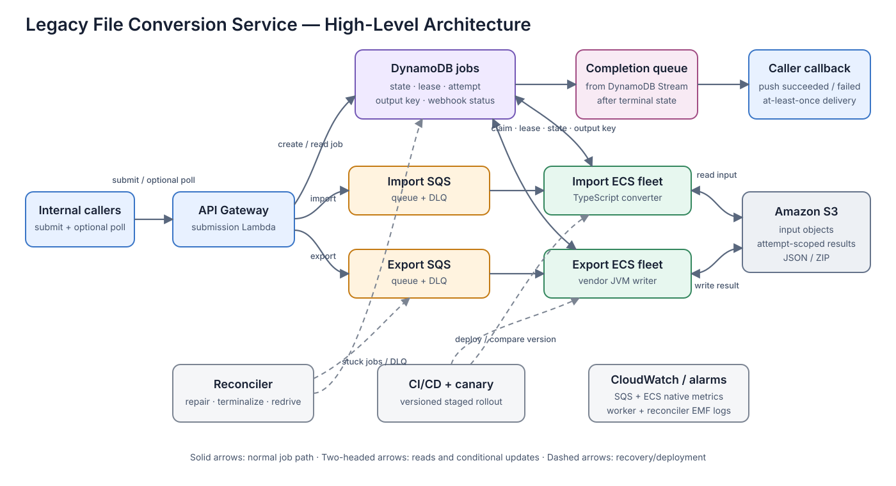

# Legacy File Conversion Service — Design Review

## Position and assumptions

I would keep API Gateway, Lambda, DynamoDB, SQS, ECS/Fargate, and S3. The smallest safe v1 changes execution, scheduling, and publication semantics rather than replacing the proposed shape. I rank risks by likelihood/time-to-impact, customer blast radius, and detectability/recovery cost.

**Explicit assumptions.** For sizing, I assume three-minute average imports, 30-minute average exports, a one-hour import and eight-hour export onboarding drain target, and 25% headroom in service maximums. One conversion runs per 1-vCPU/4-GB task; exports initially receive 100 GB of ephemeral disk. Average results are 0.25-GB JSON and 20-GB ZIP. Inputs remain available and immutable for the job lifetime, preferably pinned by S3 version/ETag. Resources are in us-east-1; result retention is a product decision, and base cost excludes internet downloads. Benchmarks, quotas, alert thresholds, retention, and vendor concurrency/licensing must be validated before launch.

## Top three risks

| Rank | Failure and customer impact | Minimum response |
|---|---|---|
| **1** | **The worker cannot support its configured concurrency.** Ten conversions need about 20 GB before runtime overhead but the task has 4 GB; they also contend for one vCPU. A 40-GB export exceeds Fargate's default 20-GB disk. This fails visibly under normal load. | One conversion per task; measure peak memory; give export a tested working set (initially 100 GB). |
| **2** | **Duplicate/stale attempts can publish the wrong artifact.** SQS is at-least-once, the claim is not atomic, attempts share a key, and an old process can finish after a retry. This is harder-to-detect data corruption. | Conditional DynamoDB lease and fencing token; attempt-scoped S3 keys; conditional publication; kill/reap timed-out converters. |
| **3** | **One queue/fleet gives unpredictable latency.** Minutes-long imports and tens-of-minutes exports count equally in queue depth; exports can starve imports during bursts. | Separate queues, DLQs, ECS services, timeouts, disk, scaling targets, and concurrency caps. Scale on estimated work, not raw depth. |

## Smallest changes

**Must-have before v1:** limit concurrency to one; split import/export queues and fleets; add conditional claim/lease/fencing and attempt-scoped publication; kill/reap with deterministic error classification; provision/test export disk; protect active ECS tasks from deployment/scale-in; reconcile missed dispatches, expired jobs, and DLQ messages; deploy with a version-labeled canary; and add free S3/DynamoDB Gateway Endpoints. **Fast-follow:** DynamoDB Streams-backed webhook delivery (polling remains the fallback), Interface Endpoints for low-volume control traffic, and fairness controls if measurements require them.

## Deliberately unchanged

- **Standard SQS:** fencing provides correctness; revisit FIFO if claim conflicts exceed 1% of deliveries or ordering becomes contractual.
- **No Step Functions:** the job has one dominant conversion step; revisit when there are at least three independently retried/compensated durable stages or more than two manual reconciliation incidents per month.

## High-level architecture



## Import and export lifecycle

1. **Submit.** Lambda validates the S3 reference and conditionally creates one `queued` job per `(caller, idempotencyKey)`; conflicting reuse is rejected. It sends to the type-specific queue and returns `202 Accepted` plus `jobId` only after both writes succeed. A failure returns `5xx`, so an idempotent caller retry can dispatch the existing job; the reconciler covers a caller that never retries.
2. **Claim.** A worker enables task protection and conditionally moves `queued` (or an expired lease) to `running` with `attemptToken`, `workerVersion`, and lease expiry. DynamoDB is authoritative. The owner extends both its DynamoDB lease and SQS visibility every minute. A duplicate loser does not ack; it defers near lease expiry. If ownership cannot be renewed before a safety margin, the owner kills/reaps the converter.
3. **Convert.** Initial values below are placeholders derived from the stated ranges; production values come from p99 plus margin.

   | | Import | Export |
   |---|---|---|
   | Converter/input | TypeScript; 10 MB–2 GB database | Vendor JVM; JSON + media |
   | Timeout and ownership window | 15-min hard timeout; 3-min lease/5-min visibility, extended | 90-min hard timeout; 5-min lease/10-min visibility, extended |
   | Working set/output | 20-GB task disk; JSON up to 500 MB | 100-GB task disk; 10–40 GB ZIP via multipart upload |
   | Error boundary | Invalid schema/table is permanent; timeout retries once; other transient platform errors allow up to three attempts | Exit 2/input errors and deterministic oversize are permanent; exit 137 or timeout retries once |

4. **Publish and notify.** The owner uploads `jobs/{jobId}/attempts/{token}/result.{json|zip}`, verifies it, and conditionally writes `succeeded` plus `outputKey`. That DynamoDB record is the publication point; stale attempts cannot publish. A terminal-state Stream enqueues an at-least-once callback with a stable event ID. Push is primary for callers supplying a callback URL; polling is the fallback.
5. **Retry or fail.** DynamoDB `attempt`, not SQS receive count, counts conversions. A second timeout fails as `TIME_LIMIT_EXCEEDED`; a second exit 137 for the same input fails as `RESOURCE_EXHAUSTED`; other transient infrastructure failures allow up to three attempts. SQS `maxReceiveCount` is high (initially 20) because duplicate losers may be received repeatedly. The DLQ consumer defers a live lease; after expiry it re-enqueues when conversion attempts and a separate delivery-failure budget remain, and marks `failed` only when either budget is exhausted.

## Operations and deployment

| Signal | Source | Initial threshold | Action |
|---|---|---|---|
| Projected drain time by job type | CloudWatch metric math: `visibleMessages × benchmarkMinutes / max(1, runningTasks)` | Import >75 min or export >9 h for 15 min | Check launch quota, scaling, throttling, and throughput; raise only the safe cap or pre-scale. Keep oldest-message age on the dashboard, not as the burst pager. |
| Failure ratio by job/error/release version | CloudWatch EMF from structured worker logs | Retryable/timeouts >5% for 15 min; new-version permanent failures >3× prior version after 20 jobs | Stop/rollback the release or inspect memory, disk, converter exits, and AWS errors. Do not blindly scale. |
| DLQ and reconciler repair count | Native SQS metrics plus reconciler EMF | Any DLQ message, or >5 repairs in 15 min | Verify jobs became terminal, investigate the leak, fix it, then controlled-redrive. |

Infrastructure, IAM, alarms, and dashboards live in CDK/Terraform. A PR runs type/lint/unit and converter-contract tests, builds/scans an immutable image, deploys staging, and converts representative fixtures. Production starts a one-task canary on the same queue; version-labeled metrics gate expansion while protected old tasks drain. Rollback scales the new service to zero and restores the prior task definition/Lambda alias. Because rollback cannot undo terminal mistakes, each attempt records `workerVersion`; jobs incorrectly failed by that version are reviewed and conditionally re-enqueued.

## Sizing and cost

The burst contains 2,400 imports and 600 exports:

```text
Import work = 2,400 × 3 / 60 = 120 task-hours
1-hour target = 120 tasks; maximum with 25% headroom = 150

Export work = 600 × 30 / 60 = 300 task-hours
8-hour target = 38 tasks; maximum with 25% headroom = 47
```

The burst itself is about `420 task-hours × $0.05826 = $24` of core Fargate compute (about $27 including extra export disk); quota and S3 throughput matter more than compute cost. Normal monthly compute is `(800 × 3/60 + 200 × 30/60) × 30 = 4,200 task-hours`, about **$245**, plus **$27** export disk. DynamoDB, SQS, Lambda, API Gateway, logs, and optional Interface Endpoints are roughly **$100–200**: four endpoints (SQS, ECR API, ECR DKR, and CloudWatch Logs) across two AZs alone are about `4 × 2 × $7.30 = $58/month`, plus data processing.

Using 4.2 TB/day of assumed output, approximate monthly totals are:

| Result retention | Steady output | S3 Standard | Total AWS/month* |
|---|---:|---:|---:|
| 7 days | 29.4 TB | $0.7k | **$1.0–1.2k** |
| 30 days | 126 TB | $2.8k | **$3.2–3.3k** |
| 90 days | 378 TB | $8.4k | **$8.7–8.9k** |

\*Rough us-east-1 public rates; excludes internet egress. S3 retention is the largest intended line item, so the single largest saving is a product-approved seven-day lifecycle while metadata remains 90 days. Free S3 and DynamoDB Gateway Endpoints are required in v1. Without the S3 endpoint, modeled NAT processing is `(6,000 exports × 40 GB read+write + 24,000 imports × 1.25 GB read+write) × $0.045 ≈ 270 TB × $0.045 = $12.2k/month`. If every export is downloaded outside AWS, about 120 TB/month of tiered data transfer could add roughly $9k–$11k.

## Follow-up risks

- Benchmark duration, memory, disk, timeout, and throughput distributions; load-test AWS quotas and vendor limits.
- Exercise duplicate delivery, heartbeat loss, deployment draining, stale publication, DLQ, webhook, and version-based re-enqueue paths.
- Finalize result retention/egress ownership, input immutability, multipart cleanup, idempotency conflicts, and log limits.
- Track per-caller backlog share; add fairness only if one caller exceeds 50% and repeatedly breaches another caller's SLO.
